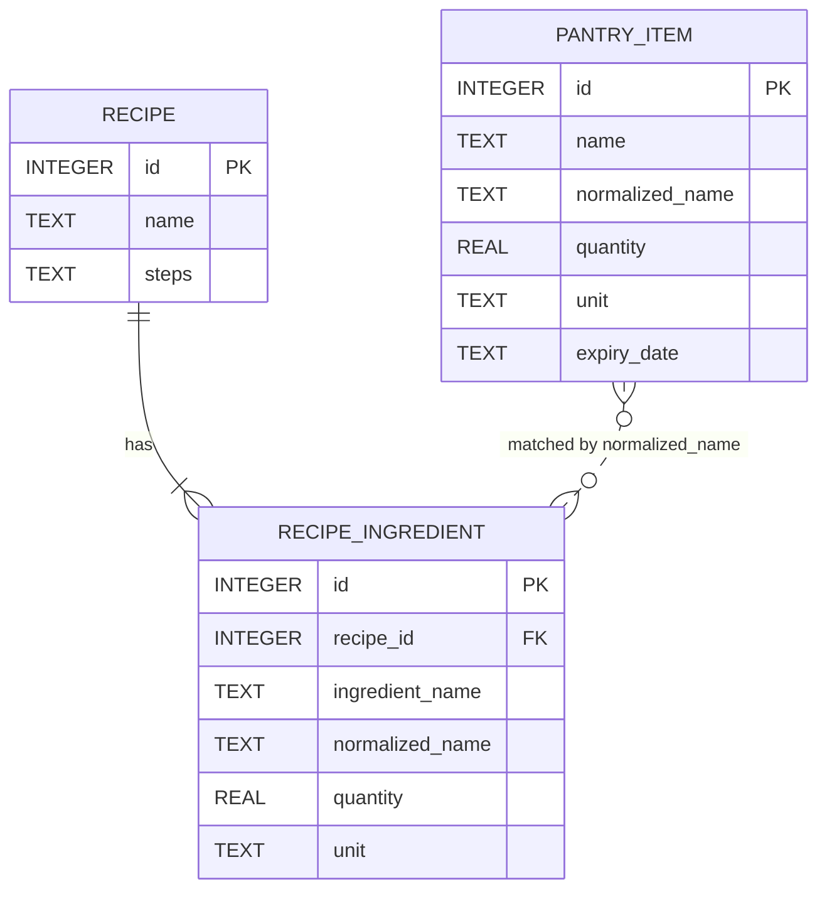

# Entity Relationship Diagram

Smart Pantry Manager stores its data in three SQLite tables. One recipe has many ingredients (a real foreign key). A pantry item is matched to a recipe ingredient by its `normalized_name` at run time, so that link is logical and not a foreign key.

